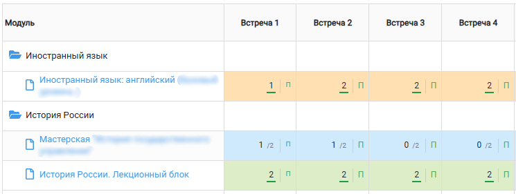
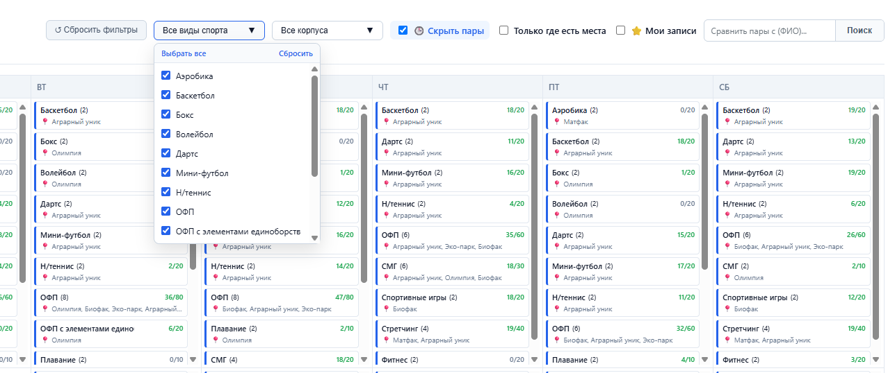

# 🎓 Modeus Student Enhancer (MSE)

[🇷🇺 Русский](README.md) | 🇬🇧 English

**Modeus kicks you out mid-session. Buildings are labeled with cryptic codes. Grades are bare numbers with no context.**
This is a free browser extension that fixes all of that — and adds some useful extras on top.

> **Modeus Student Enhancer** — a browser extension for [UTMN Modeus](https://utmn.modeus.org): human-readable building names, teacher reviews, friends' schedules and shared classes in one click, maximum scores in grades, smart PE section picker, and protection against sudden session logouts.

---

## Why do you need this?

| 😫 Regular Modeus | 😎 Modeus with MSE |
| :--- | :--- |
| Constant session logouts | Protects against logouts; with "Remember me" enabled — no more logouts at all |
| Codes like "Building-01", "Building-11" | Human-readable names and addresses ("Main Building", "SocHum") |
| Picking electives blindly | Student reviews on hover over any teacher's name |
| Searching for free slots with friends via Telegram screenshots | A friends list, their schedule from the sidebar, and shared classes highlighted in one click |
| Bare numbers in grades | Fraction with maximum per class (7.5 / 10) |
| Endless list of PE sections | A unified weekly grid of all sections, filtered by your schedule and your friend's |

---

## How it looks:

| Transparent grades | Smart PE picker |
| :---: | :---: |
|  Fraction with maximum per class |  Filters + weekly grid · *click to zoom* |

## How to install

The extension works in any popular desktop browser (**Yandex Browser, Google Chrome, Edge, Opera, Brave**). It's not in the extension store yet, so installation is manual — just a couple of clicks:

1. Download the archive from the [latest release](https://github.com/student1245/Modeus-Student-Enhancer/releases/latest) page (scroll down to the Assets section and click the .zip file).
2. **Unpack the archive** to any convenient folder on your computer (e.g., Documents).

   > ⚠️ **Important:** Do not delete or move this folder after installation — the browser runs the extension directly from it.

3. Open your browser's extensions page by copying the address from the table below into the address bar and pressing Enter.
4. Enable **"Developer mode"** (toggle in the top-right corner).
5. Click "Load unpacked" and select the folder.
6. Go to [Modeus](https://utmn.modeus.org/schedule-calendar/) — everything works!

### Which browser do I have?

| Browser | Extensions page | Support |
| :--- | :--- | :---: |
| Google Chrome / Chromium | `chrome://extensions` | ✅ |
| Yandex Browser | `browser://extensions` | ✅ |
| Microsoft Edge | `edge://extensions` | ✅ |
| Opera | `opera://extensions` | ✅ |
| Brave | `brave://extensions` | ✅ |
| Vivaldi | `vivaldi://extensions` | ✅ |
| Firefox | — | ❌ not supported |
| Safari | — | ❌ not supported |
| Mobile browsers (Android / iOS) | — | ❌ extensions don't work there |

---

> ⚠️ **Do not turn off "Developer mode" after installation.** Starting from Chrome 134, the browser automatically disables unpacked extensions as soon as this toggle is switched off. Keep it on — it's safe.

## Is this safe?

- **Can I trust this extension?** The code is open — you can read every single line right here in this repository, no compiling or running anything required.
- **Where is my password stored with "Remember me"?** In your browser's local storage — on your device only, used exclusively on the official UTMN login page, and wiped on logout or any login error.
- **Can MSE change my grades or schedule?** No. The extension only overlays information on top of the Modeus interface and renews your own session. Nothing in the system is modified.
- **Is this an official university project?** No. MSE is a student initiative, not affiliated with UTMN or the Modeus platform.

---

## Feedback

Can't install it, found a bug, or have a cool idea for a new feature?
- Message our Telegram bot directly: **[@Theguestroom_bot](https://t.me/Theguestroom_bot)** (the link is also always at the bottom of the Modeus sidebar).
- Or open an issue in the [Issues](https://github.com/student1245/Modeus-Student-Enhancer/issues) tab of this repository.

---

## For developers
A detailed technical breakdown of the architecture is available in [docs/architecture.md](docs/architecture.md).
